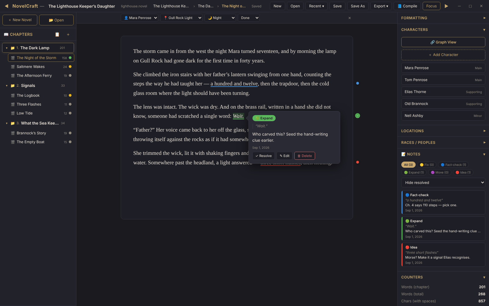
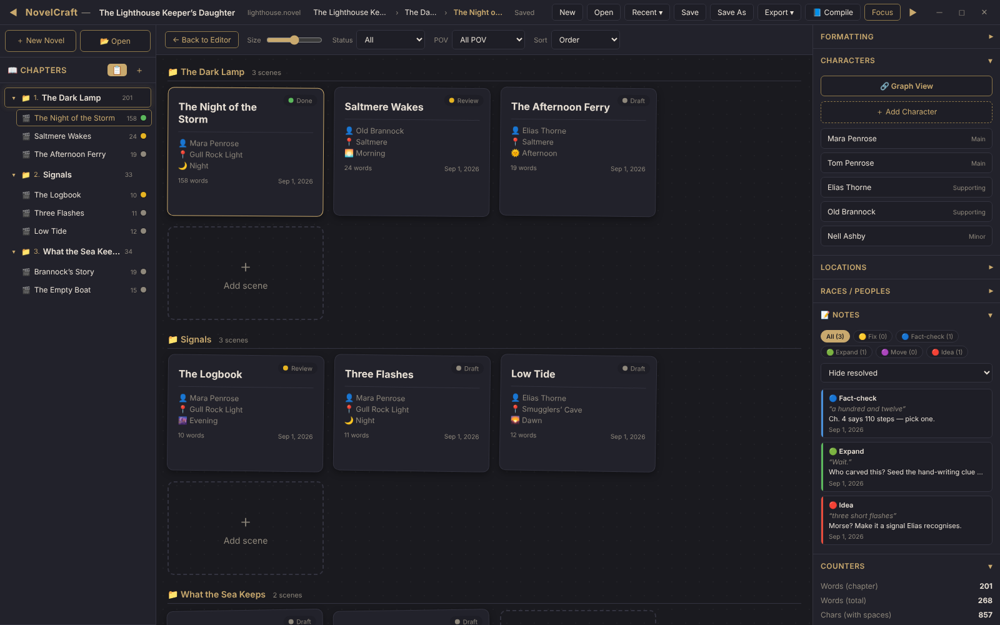
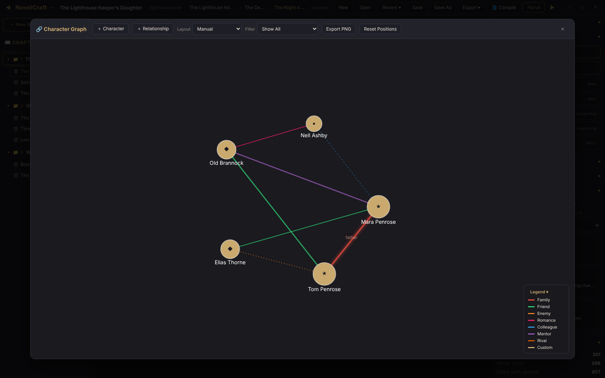
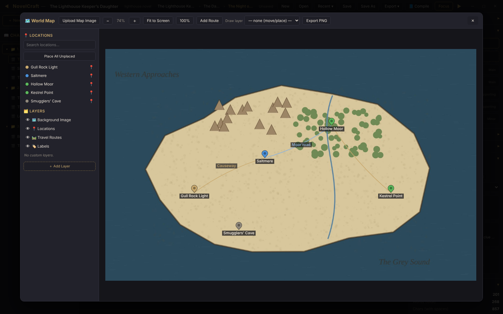
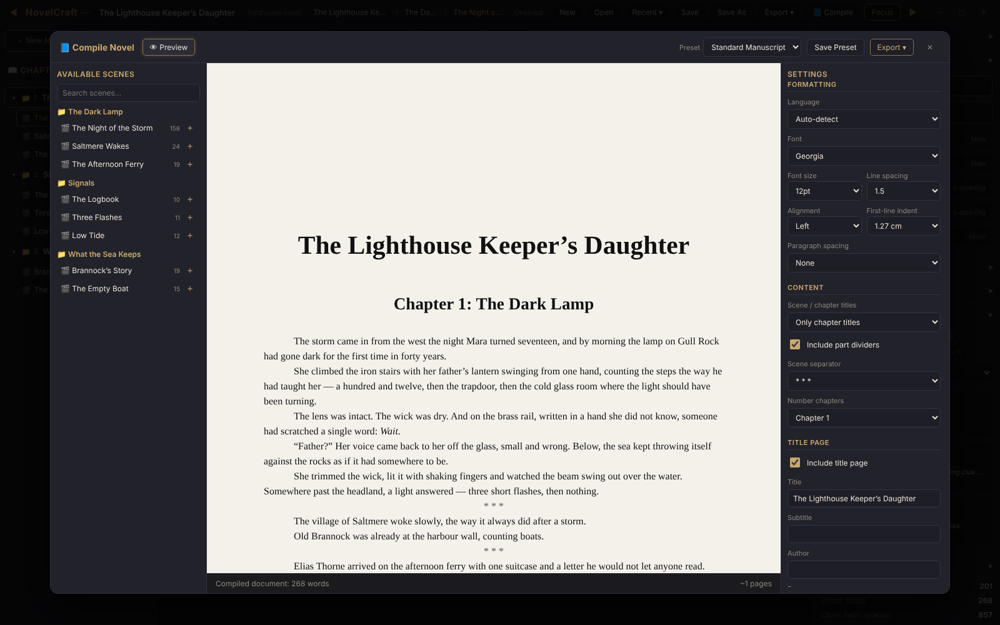

# NovelCraft

**A distraction-free studio for writing novels**, for Windows, macOS and Linux. Write in scenes,
keep your characters, places and notes next to the text, and turn the finished manuscript into a
PDF, EPUB or Word file in one click. Everything about a novel lives in a single `.novel` file on
your computer — no account, no cloud.

[](https://github.com/UnKnownHelp69/novel-craft/actions/workflows/ci.yml)




## Download

Get the installer for your system from the
**[Releases page](https://github.com/UnKnownHelp69/novel-craft/releases)** (open the newest
release and look under *Assets*):

| System | File to download |
|---|---|
| **Windows** 10 / 11 | `NovelCraft_…_x64-setup.exe` (or the `.msi`) |
| **macOS** (Apple Silicon and Intel) | `NovelCraft_…_universal.dmg` |
| **Linux** | `.AppImage` (runs anywhere), `.deb` (Debian, Ubuntu, Mint) or `.rpm` (Fedora, openSUSE) |

The builds are not code-signed yet, so the system warns the first time you start the app:

- **Windows** — SmartScreen says "Windows protected your PC": click **More info**, then **Run anyway**.
- **macOS** — "cannot be opened because the developer cannot be verified": right-click the app in
  *Applications*, choose **Open**, then **Open** again. This is needed only once.
- **Linux (AppImage)** — make the file executable first (`chmod +x NovelCraft_*.AppImage`, or
  *Properties ▸ Permissions ▸ Allow executing* in your file manager).

## What it does

**Chapters and scenes.** A chapter is a folder of scenes; a scene is what you write in. Each scene
has a status (draft / review / done), a point-of-view character, a location and a time of day.
Drag scenes and chapters to reorder them. Deleting is instant and can be undone from the message
that pops up.

**A calm editor.** A clean page with headings, bold and italic, a per-selection font and an
optional Markdown mode. Focus mode hides everything but the page. Text pasted from Word or a web
page keeps its formatting, but none of the clutter.

**Margin notes.** Select a phrase and attach a note to it — *fix*, *fact-check*, *expand*,
*move*, *idea* or your own types. Notes stay attached to their words while you edit, show up as
coloured dots in the margin, and can be exported as a list (text or Markdown).

**Corkboard.** All scenes as index cards, chapter by chapter. Filter them by status or
point-of-view character, and drag cards to change the order.



**Characters, places and peoples.** Keep a profile for every character, location and race. The
**character graph** shows who is related to whom — family, friends, rivals, love — and the
**world map** puts your locations on a map image of your own, with travel routes and drawing
layers. Both export to PNG.





**Compile the book.** Choose the scenes and their order, add part titles and section breaks, a
title page and a table of contents, then export **PDF, EPUB (e-readers), DOCX (Word), HTML or
TXT**. The app builds these files itself — nothing else needs to be installed. Your settings can
be saved as presets for the next time.



**Russian and every other language.** Word counts, keyboard shortcuts and every export work with
Cyrillic and any other script. Chapter headings and the table of contents in exported books are
in English or Russian, detected from the text or chosen by hand.

## Your work is safe

- A novel is **one `.novel` file**, saved wherever you choose. It is plain text (JSON), so it can
  be backed up, synced or put under version control like any other document.
- While you have unsaved changes, NovelCraft **saves to that file on its own every 30 seconds**.
  `Ctrl+S` saves right away.
- If the computer crashes, the next launch **offers to restore** what you were writing.
- Saving also keeps **earlier versions** of the file (up to one every 10 minutes, for 30 days).
  **File ▸ Restore from Backup…** brings one back — and that can be undone too.
- A `.novel` from someone else is safe to open: anything in it that could run code is removed.

Details — where these files live on each system and what the format looks like — are in the
[development guide](docs/DEVELOPMENT.md#where-data-lives).

## Keyboard shortcuts

`Ctrl` on Windows/Linux, `Cmd` on macOS.

| Action | Shortcut |
|--------|----------|
| Save / Save As | `Ctrl+S` / `Ctrl+Shift+S` |
| Open | `Ctrl+O` |
| Bold / Italic | `Ctrl+B` / `Ctrl+I` |
| Undo / Redo | `Ctrl+Z` / `Ctrl+Shift+Z` |
| Focus mode | `Ctrl+Shift+F` (`Esc` to leave) |
| Add a margin note to the selection | `Ctrl+Shift+M` |
| Previous / next note (while a note is open) | `Ctrl+↑` / `Ctrl+↓` |
| Character graph | `Ctrl+G` |
| Hide / show the left or right panel | `Ctrl+\` / `Ctrl+/` |
| Close the open window (graph, map, corkboard, compile, note) | `Esc` |

Shortcuts work on any keyboard layout: on a Russian layout `Ctrl+S` is the same key as `Ctrl+Ы`.

## Building it yourself

You need [Rust](https://rustup.rs), [Node.js](https://nodejs.org) 20.11 or newer, and the
[system packages Tauri needs](https://v2.tauri.app/start/prerequisites/). Then:

```bash
npm install
npm run build
```

The installers appear under `src-tauri/target/release/bundle/`. Running from source, the tests,
the file format and everything else technical are in the **[development guide](docs/DEVELOPMENT.md)**.

## License

[MIT License with the Commons Clause](LICENSE). © 2026 UnKnownHelp69.

- **Free to use** — personally or professionally — and free to copy, modify and share, as long
  as nothing is charged for it.
- **Not for sale:** you may not sell NovelCraft, a modified version of it, or a paid service or
  support whose value comes mainly from it. Copies and modified versions must keep the license,
  Commons Clause included.
- **Your writing is yours.** The license covers the program only. What you write and export with
  it — texts, books, PDF/EPUB/DOCX files — belongs to you, and you may publish and sell it freely.

Because of the selling restriction this is a *source-available* license, not an OSI open-source
one. Versions published before this change remain available under the plain MIT License.

---

NovelCraft was built together with an AI coding agent (Claude Code).
